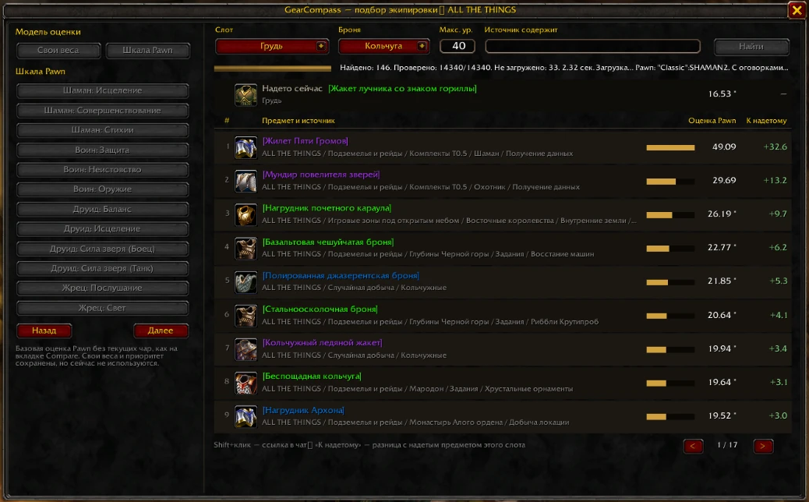
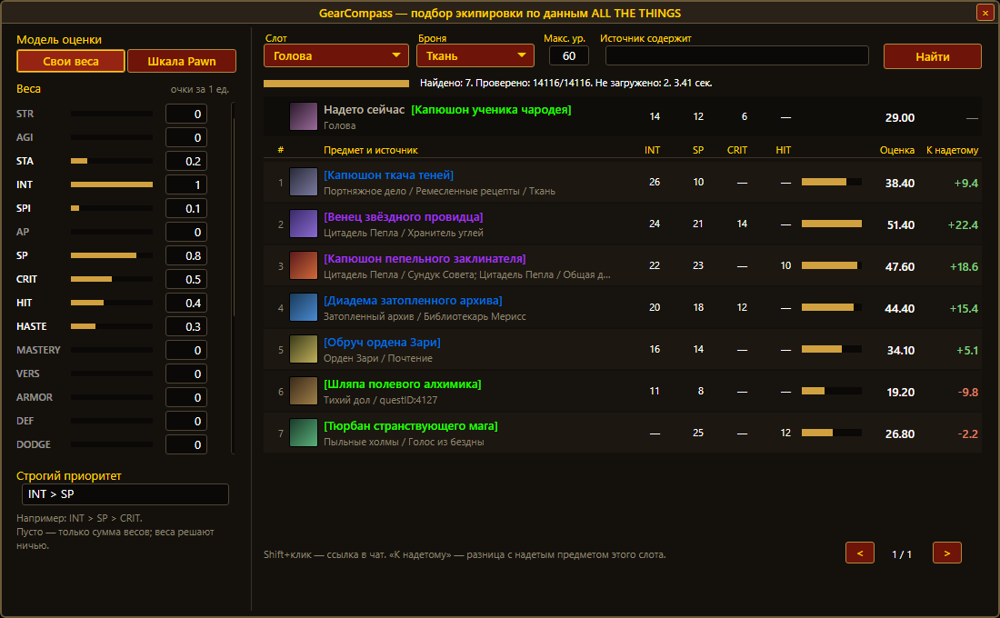

# GearCompass 0.4.1 — подбор экипировки для WoW Forever

Рейтинг отдельных предметов по вашим весам характеристик или строгому порядку приоритетов. Каталог и источники читаются из установленного **ALL THE THINGS (ATT)**, характеристики — из API WoW. В SavedVariables сохраняются только настройки персонажа. AtlasLoot больше не требуется.

## Интерфейс

Оценка шкалой Pawn (снимок из игры, поиск ещё идёт): слева список шкал, справа строка надетого предмета и таблица кандидатов с разницей к нему; `*` отмечает оценку с нераспознанными строками.



Свои веса и строгий приоритет: все характеристики в прокручиваемом списке слева, в таблице появляются колонки статов. Это изображение — макет по раскладке `UI.lua`, а не снимок из игры; предметы и оценки на нём условные.



## Установка

1. Установите [ALL THE THINGS с поддержкой Forever](https://www.curseforge.com/wow/addons/all-the-things).
2. Из установочного ZIP скопируйте папку `GearCompass` в `World of Warcraft/_forever_/Interface/AddOns/`. При обновлении замените предыдущую папку целиком. Исходные Lua-файлы и `GearCompass.toc` лежат в корне репозитория; `.tools`, `tests` и `dist` для игры не нужны.
3. Перезапустите клиент, включите оба аддона, дождитесь загрузки ATT и выполните `/gc` (также `/gearcompass`).

Веса изначально нулевые: задайте собственный профиль. Слева в окне перечислены все характеристики (список прокручивается, Tab переходит к следующему полю); полоска рядом показывает вес относительно самого большого, характеристики с весом 0 притушены. Например: INT 1, SP 0.8, CRIT 0.5, STA 0.2.

Оценка = сумма `количество стата × вес`. Десятичные запятые и отрицательные веса поддерживаются. Это пример синтаксиса, а не рекомендация для класса.

Поле приоритета можно оставить пустым, чтобы использовать только веса. `INT > SP > CRIT` включает строгое сравнение: любой дополнительный INT важнее любого количества SP; при равном INT сравнивается SP, затем CRIT. После равенства всех приоритетов используется сумма весов.

Слот и тип брони выбираются из выпадающих списков. Уровень ограничивает требуемый уровень предмета; источник фильтруется по подстроке. Полоса над таблицей показывает ход поиска. Используются только характеристики, которые возвращает `GetItemStats`.

Результаты показаны таблицей по 9 строк на страницу, с подсказками при наведении; Shift+клик вставляет ссылку в чат. Колонки характеристик — до четырёх: сначала статы из приоритета, затем с наибольшим по модулю весом (в режиме Pawn колонок нет). Полоска оценки отсчитывается от лучшего найденного предмета.

Строка **«Надето сейчас»** над таблицей показывает предмет в выбранном слоте и его оценку той же моделью. Колонка **«К надетому»** — разница оценки кандидата и надетого предмета его слота (для «Все слоты» — слота каждого кандидата). Кольца и аксессуары сравниваются с более слабым из двух надетых, пустой слот имеет оценку 0. Одноручное и двуручное оружие сравнивается только с предметом в правой руке; левая рука при этом не учитывается. Пока данные надетого предмета не загружены, разница не показывается.

## Источник данных ATT

- Адаптер проверен по исходникам релиза ATT 5.4.13. Использует `AllTheThings.GetRawFieldContainer("itemID")` стандартной базы клиента Forever (`IsForever`). Настройки видимости коллекций ATT не ограничивают каталог GearCompass.
- Предметы объединяются по ID; у каждого сохраняются разные пути получения через родительские узлы ATT. Если локализованное название ещё не загружено, показывается идентификатор вроде `questID:900`.
- Скрытые базы ATT (`NeverImplemented` и другие отдельные кэши) не читаются. Записи с `u <= 2` у предмета или предка исключаются согласно логике ATT `InGame`. Другие ограничения доступности автоматически не проверяются.
- Источник отражает структуру ATT, а не доказательство доступности предмета. Класс, фракцию, фазу, репутацию, профессию и возможность использовать оружие проверяйте отдельно.
- После обновления ATT перезагрузите интерфейс и повторите поиск. Изменение API ATT может потребовать обновления адаптера. Пустой кэш выдаёт сообщение о необходимости дождаться загрузки.
- ATT содержит предметы всех типов. Сначала отбрасываются известные неэкипируемые категории через `GetItemInfoInstant`; затем экипировка и характеристики проверяются через `GetItemInfo` и `GetItemStats`.

## Pawn

Pawn — необязательный модуль оценки. Без него доступны собственные веса и строгие приоритеты GearCompass.

1. Установите [Pawn для Forever](https://www.curseforge.com/wow/addons/pawn/files/9599905) и настройте или импортируйте шкалу через `/pawn`.
2. Откройте `/gc` и в блоке «Модель оценки» слева нажмите **«Шкала Pawn»**.
3. Выберите шкалу Pawn из списка (есть страницы) и нажмите **«Найти»**. Выбранные режим и внутренний ID шкалы сохраняются для персонажа. Профиль выбирается явно и не меняется автоматически со специализацией.
4. Для возврата нажмите **«Свои веса»**. Настройки собственного профиля сохраняются, но в режиме Pawn они не используются и скрыты.

Адаптер проверен по Pawn 2.14.3. Получает шкалы через `PawnGetAllScalesEx`, данные — через `PawnGetItemData`, оценку — через `PawnGetSingleValueFromItem`. Берётся **второе, базовое значение**: так делает вкладка Compare самого Pawn. Текущие чары не добавляются к сравнению; расчёт сокетов и прочие поддержанные правила остаются на стороне Pawn. В этом режиме `GetItemStats` не нужен: распознавание статов полностью выполняет Pawn. Предметы с `CanEquip == false` пропускаются.

Нулевая оценка допустима; отсутствующая оценка ожидает данных и не подменяется нулём. Предметы без распознаваемых статов тоже могут остаться без оценки. При отсутствующем Pawn, несовместимом API или удалённой шкале показывается ошибка, без скрытого перехода к другой модели. Ошибка вызова API останавливает поиск и возвращает доступность кнопке поиска.

Если Pawn сообщает `UnknownLines`, балл помечается `*`, а подсказка предупреждает о нераспознанных свойствах. Это не гарантия обнаружения всех неучтённых эффектов. Первый поиск может быть медленнее из-за чтения подсказок Pawn; работа остаётся порционной. Оценки Pawn не кэшируются GearCompass между поисками: используются кэш и механизмы пересчёта самого Pawn. Изменение весов/экспортной строки или нормализации шкалы во время поиска прерывает его — повторите поиск, чтобы получить единый рейтинг. Другие общие настройки Pawn лучше менять между поисками.

Pawn не предоставляет полный каталог предметов. По [документации автора](https://github.com/VgerMods/Pawn) бонусы комплектов и специальные эффекты, которые нельзя выразить статами, не учитываются. Его веса — упрощённая модель, а не симуляция DPS/HPS.

## Ограничения

- Это рейтинг кандидатов, а не доказанный BiS комплект: нет симуляции DPS/HPS, капов, проков, бонусов комплектов, чар, камней и совместной оптимизации оружия/колец.
- Найденные предметы появляются по мере поиска, до завершения загрузки неизвестных. Поиск выполняется порциями до 400 записей с бюджетом обработки 3 мс на шаг (если доступен таймер профилирования клиента). Сортировка и перерисовка выполняются отдельно от этого бюджета. Удалён прежний предел 40 записей раз в 50 мс, который давал около 17,65 секунды на 14 116 ID.
- Каталог ATT и загруженные характеристики кэшируются в памяти до `/reload`; оценки пересчитываются по текущим весам. Пути получения собираются только для кандидатов и также кэшируются. Изменение настроек поиска не требует повторной загрузки уже прочитанных характеристик. События ATT `OnDataCached` и `OnReady` сбрасывают кэш каталога.
- Неизвестный предмет запрашивается один раз за поиск. Повторная проверка происходит по `ITEM_DATA_LOAD_RESULT`; резервная проверка выполняется не чаще раза в секунду. По истечении 8 секунд поиск завершается с известными результатами и числом незагруженных предметов; большой первоначальный проход может занять больше времени. Для новой попытки повторите поиск. Обновление данных предметов во время сессии может потребовать `/reload`.
- Броня фильтруется по типу, но пригодность для класса и требования не проверяются. Грудь и одеяния, а также разные типы оружия представлены отдельными фильтрами.
- В клиенте Forever проверена основная работа окна: поиск с ATT, свои веса и приоритет, шкалы Pawn, сравнение с надетым. TOC использует Interface `16001`, который указан для Forever в проверенном ATT. Проверьте `/dump select(4, GetBuildInfo())` в своём клиенте при несовпадении версии.

## Проверка

Тесты используют Lua 5.1 через `lupa`. Зависимости и скачанные сторонние аддоны не входят в ZIP GearCompass.

```powershell
python -m pip install --target .tools lupa
python tests/run.py
python tests/run.py <путь к распакованному архиву ATT>
python tests/run.py <путь к распакованному архиву ATT> <путь к папке Pawn>
```

## Сборка и релиз

`python scripts/build.py` собирает `dist/GearCompass-<версия>.zip`: версия и список Lua-файлов берутся из `GearCompass.toc`, к ним добавляются `LICENSE` и `README.md`.

GitHub Actions (`.github/workflows/ci.yml`) на каждый push в `main` и pull request запускает тесты (без необязательных проверок на архивах ATT и Pawn) и прикладывает собранный ZIP к запуску как артефакт. Чтобы выпустить версию:

1. Поднимите `## Version:` в `GearCompass.toc` (и заголовок README), закоммитьте и запушьте.
2. Создайте и запушьте тег `v<версия>`. Сообщение аннотированного тега станет описанием релиза:

```powershell
git tag -a v0.4.1 -m "Описание изменений"
git push origin v0.4.1
```

Workflow проверит, что тег совпадает с версией в TOC, соберёт архив и опубликует релиз с ним. Если релиз с этим тегом уже создан вручную, архив будет добавлен к нему.

Проверяются парсер, веса, приоритеты, объединение источников ATT, исключение несуществующего контента, отсутствие/неготовность ATT, асинхронная загрузка, фильтры и таймаут.

Также проверяются необязательность Pawn, выбор шкалы в UI, базовая/нулевая/отсутствующая оценка, нераспознанные строки, смена шкалы, изменение настроек, API-ошибки и бюджет обработки дорогих вызовов. Дополнительный тест с папкой Pawn выполняет настоящие функции списка шкал, экспорта и расчёта базового балла из релиза; получение подсказок и окружение игры заменены заглушками. Полный запуск Pawn в WoW этим не проверяется.

Тест производительности на 14 116 ID проверяет показ результатов менее чем за одну секунду виртуального времени, завершение по событию загрузки, отсутствие повторных вызовов API характеристик при смене весов, ограничение повторов и отмену поиска. Это тест планировщика на заглушках, а не замер FPS или времени сервера WoW.

Дополнительная проверка выполняет настоящие файлы `db/Camelot/Categories` с заглушками конструкторов объектов ATT. Для 5.4.13 прочитано 14 116 уникальных ID всех типов, исключено 35 ссылок. Это проверка формата данных, а не полноценный запуск ATT или подтверждение доступности предметов в игре.

В игре: открыть `/gc`, задать ненулевые веса, выбрать слот и уровень, выполнить поиск, сверить предмет/источник с ATT и подсказкой; повторить с приоритетами и после `/reload`.

Для Pawn: выбрать свою шкалу, проверить несколько предметов на вкладке Compare Pawn и сопоставить базовые оценки; сменить веса, повторить поиск и проверить пересчёт. Отдельно проверить незагруженный предмет, предмет с проком, неподходящий класс и возврат к собственным весам.
